# 🐑 Cyber Shepherd (Siber Çoban) — Smart Livestock Tracking & Virtual Fencing System

<p align="center">
  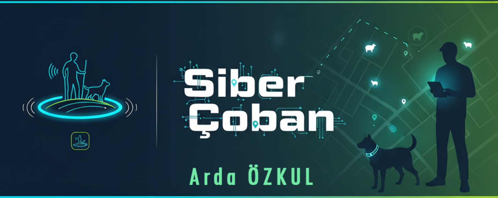
</p>

<p align="center">
  
  
</p>

<p align="center">
  🏆 <b>TÜBİTAK 2204-A Lise Araştırma Projeleri Yarışması (2026) — Teknoloji ve Tasarım Alanı:</b><br>
  🥇 <b>Bölge Birincisi (Regional 1st Place Champion)</b> &nbsp;|&nbsp; 🎖️ <b>Türkiye 4.lüğü (National 4th Place Finalist)</b>
</p>

<p align="center">
  <b>🇬🇧 <a href="#-english-documentation">English Documentation</a> | 🇹🇷 <a href="#-türkçe-dokümantasyon">Türkçe Dokümantasyon</a> | 📸 <a href="#-screenshots--hardware-gallery--ekran-görüntüleri-ve-donanım-galerisi">Screenshots & Hardware Gallery</a></b>
</p>

---

# 📸 Screenshots & Hardware Gallery / Ekran Görüntüleri ve Donanım Galerisi

### 🎖️ TÜBİTAK 2204-A Award Ceremony / Ödül Töreni

<p align="center">
  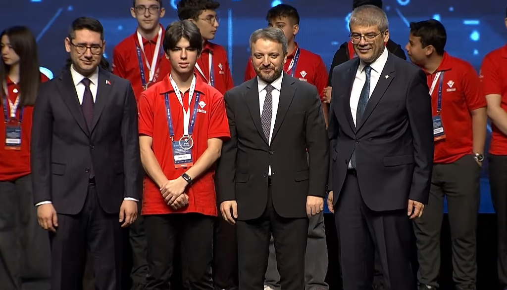
  <br>
  <em>TÜBİTAK 2204-A Araştırma Projeleri Ödül Töreni (30 Nisan 2026) — Arda ÖZKUL &nbsp;|&nbsp; 🎥 <a href="https://www.youtube.com/live/NBXWoSTFw_w?t=4961s">Canlı Yayın Kaydı (1:22:41)</a></em>
</p>

### 🔌 Real Hardware Prototype (ESP32-C3 Smart Collar / Akıllı Tasma Prototipi)

| **Hardware Architecture (Presentation Prototype)**<br>*ESP32-C3 SuperMini, 0.42" OLED, GY-NEO6MV2 GPS + Ceramic Antenna, Ra-01 LoRa SX1278, Active Buzzer, Vibration Motor & Status LED* | **Live Collar Operation (Wi-Fi / Hotspot Gateway Mode)**<br>*ESP32-C3 powered on with 0.42" OLED displaying real-time gateway search (`SERVER ARANIYOR 192.168.43.1`)* |
| :---: | :---: |
| 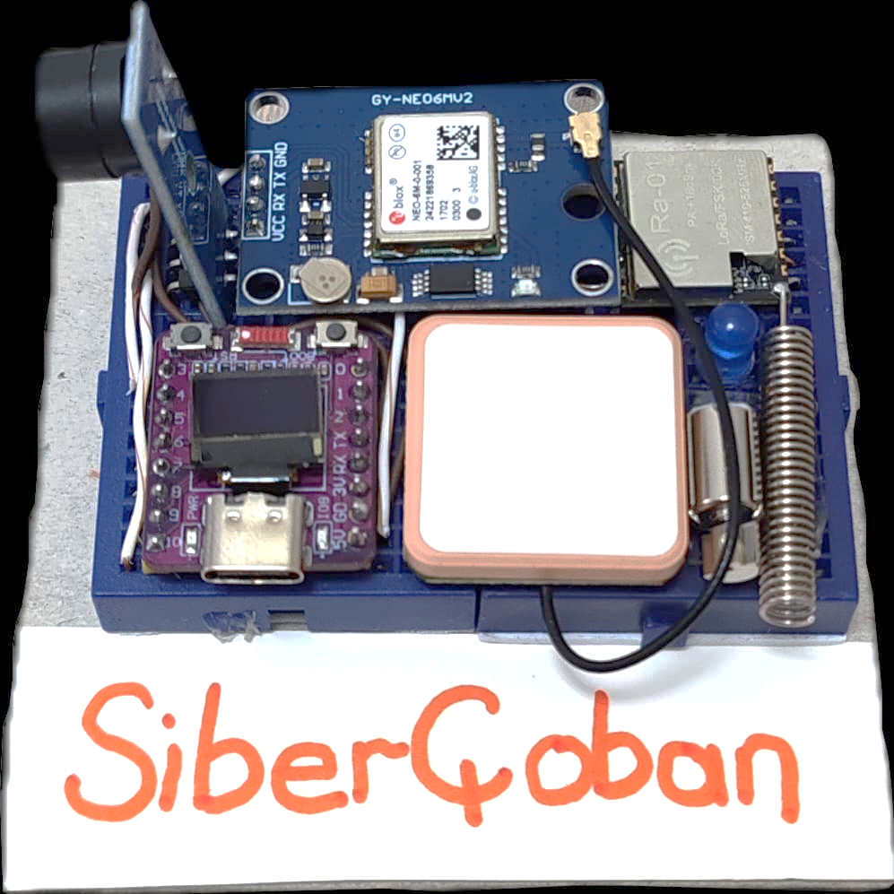 | 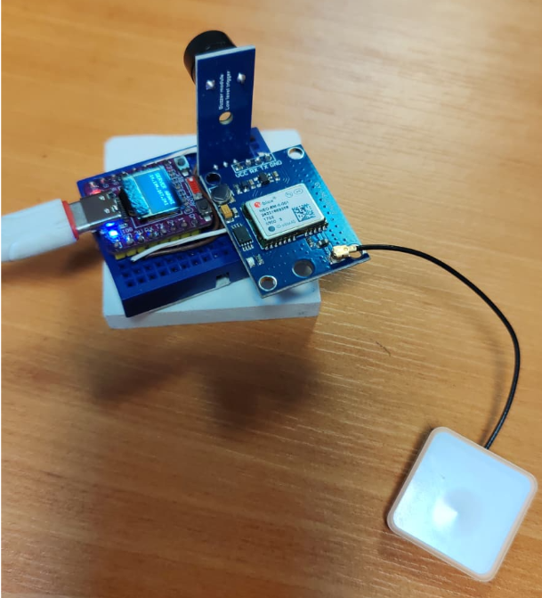 |

### 🌐 Web GIS Simulation & Dynamic Virtual Fence Interface (`sibercobanv2.html`)

| **1. Gathering & Safe Corridor Transit (`Toplama`)**<br>*Barns 1–5 connected to the grazing polygon via auto-generated corridors* | **2. Active Autonomous Grazing (`Otlama`)**<br>*Herd (50 Sheep, 25 Goats, 15 Cattle) grazing inside virtual polygon boundaries* |
| :---: | :---: |
| 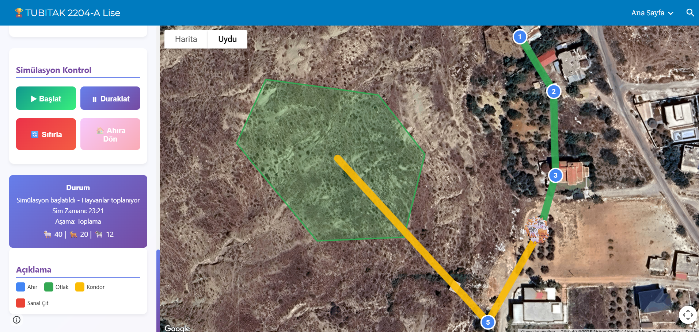 | 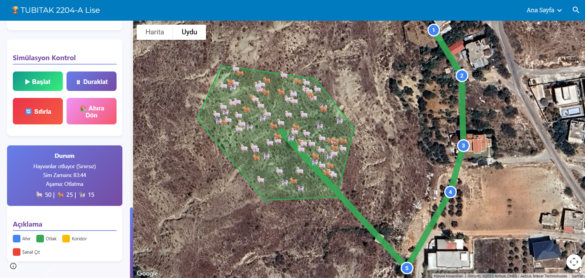 |
| **3. Dynamic Virtual Fence Shrinking (`Dinamik Çit Daralması`)**<br>*Polygon boundary shrinks progressively (`%47 -> %12`) to gather the herd* | **4. Guided Return to Barn (`Ahıra Geri Dönüş`)**<br>*Herd autonomously guided back to their respective barns along the corridor* |
| 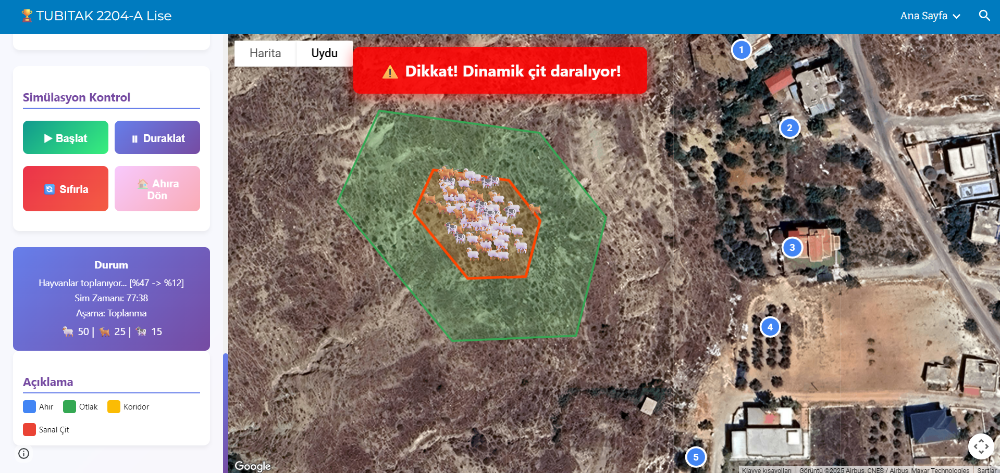 | 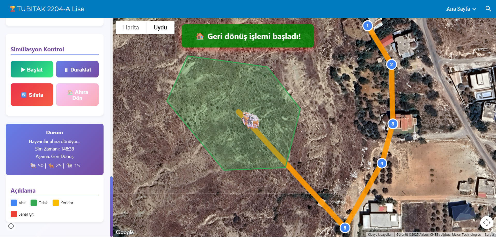 |

| **5. End-of-Day Herd Analytics (`Gün Sonu Raporu`)**<br>*Summary report after all livestock safely return to their barns* | **6. Mobile / Field Tablet Real-Time Breach Alert**<br>*Field operator map view alerting when an animal crosses the virtual boundary* |
| :---: | :---: |
| 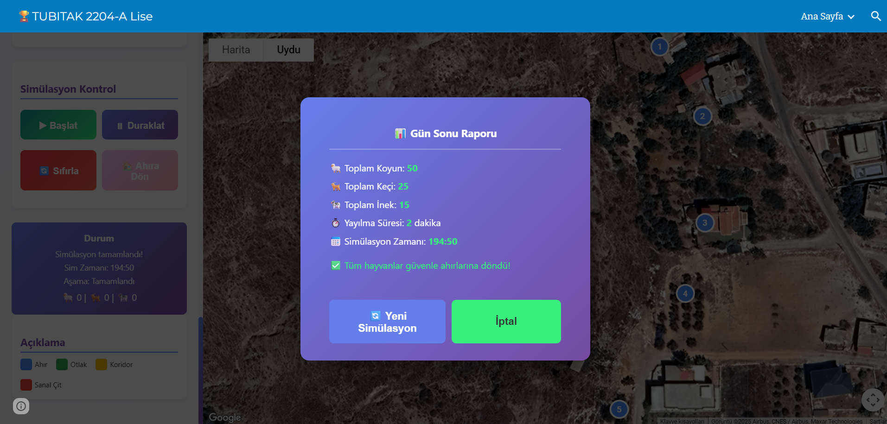 | 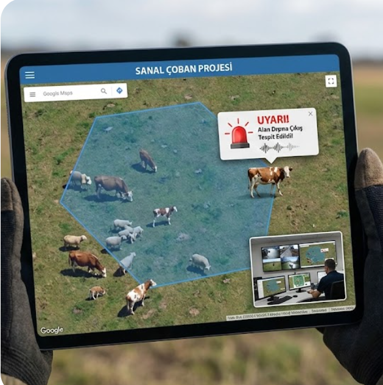 |

<p align="center">
  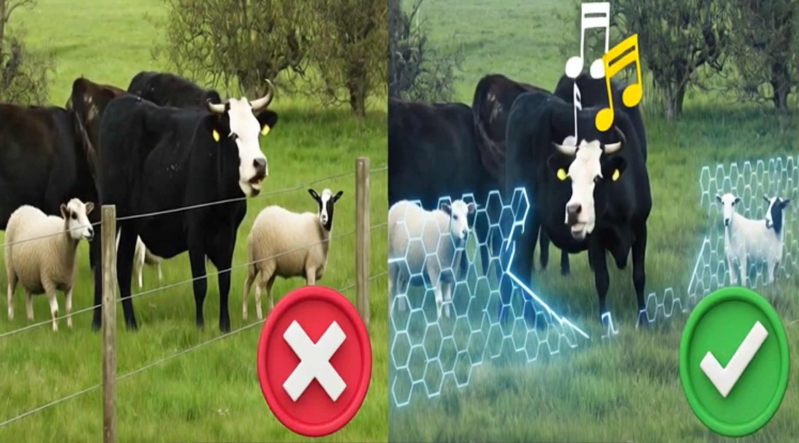
  <br>
  <em>Physical Barbed Wire Fence (❌ Injury risk & high cost) vs. Cyber Shepherd Virtual Fence with Acoustic Stimulus (✅ Safe, dynamic & cost-effective)</em>
</p>

---

# 🇬🇧 English Documentation

## 🏆 Honors & Recognition
- **Competition:** TÜBİTAK 2204-A High School Research Projects Competition (2026)
- **Field / Category:** Technology & Design (Teknoloji ve Tasarım)
- **Awards:** 🥇 **Regional Champion (1st Place)** &nbsp;|&nbsp; 🎖️ **National Finalist (4th Place Nationwide)**
- **Date of Award:** April 30, 2026 (30 Nisan 2026)
- **Ceremony Record:** 🎥 [Official Live Stream Broadcast (Timestamp 1:22:41)](https://www.youtube.com/live/NBXWoSTFw_w?t=4961s)

## 📖 Overview

**Cyber Shepherd (Siber Çoban)** is an end-to-end IoT and mobile/web software ecosystem designed for autonomous livestock tracking, virtual geofencing, and dynamic herd management. By combining a **Web-based GIS Simulation & Planning Interface**, an **Android Mobile Gateway & Control Application**, and **ESP32-C3 Smart Collar Nodes**, the system keeps livestock within designated grazing boundaries without physical fences and guides them back to the barn using dynamic polygon shrinking algorithms.

---

## 🏗️ System & Hardware Architecture

The system operates on a 3-tier distributed architecture:

```
┌─────────────────────────────────────────────────────────────────────────┐
│                     1. WEB PLANNING & SIMULATION                        │
│                         (sibercobanv2.html)                             │
│  • Barn placement, polygon grazing zones & safe corridor generation     │
│  • Swarm physics simulation & JSON scenario export                      │
└───────────────────────────────────┬─────────────────────────────────────┘
                                    │ JSON Master Plan
                                    ▼
┌─────────────────────────────────────────────────────────────────────────┐
│                2. ANDROID GATEWAY & CONTROL APPLICATION                 │
│                            (android_app/)                               │
│  • Wi-Fi Hotspot TCP Server (Port 8080) & Bluetooth SPP Controller      │
│  • Real-time multi-animal GPS telemetry tracking on Google Maps         │
│  • Broadcasts Geofence Polygons & Commands (START / RETURN / STOP)      │
└─────────────────┬───────────────────────────────────┬───────────────────┘
                  │ Wi-Fi TCP / LoRa / Bluetooth      │ Wi-Fi TCP / LoRa / Bluetooth
                  ▼                                   ▼
┌───────────────────────────────────┐ ┌───────────────────────────────────┐
│   3. ESP32-C3 SMART COLLAR #1     │ │   3. ESP32-C3 SMART COLLAR #N     │
│  • Real-time GPS Acquisition      │ │  • Real-time GPS Acquisition      │
│  • On-device Ray-Casting Geofence │ │  • On-device Ray-Casting Geofence │
│  • Dynamic Polygon Shrinking      │ │  • Dynamic Polygon Shrinking      │
│  • Acoustic & Haptic Deterrent    │ │  • Acoustic & Haptic Deterrent    │
└───────────────────────────────────┘ └───────────────────────────────────┘
```

### 🔧 Required Hardware (Per Smart Collar Node)

To run the full field setup with the software in this repository, each wearable collar unit is built around the following hardware components:

| Component | Model / Specification | Purpose |
| :--- | :--- | :--- |
| **Microcontroller** | **ESP32-C3 SuperMini** (RISC-V 160MHz, 4MB Flash, Wi-Fi + BLE) | Core processing, Wi-Fi TCP client & BLE communication, Ray-Casting boundary math |
| **GNSS / GPS Module** | **GY-NEO6MV2 (u-blox NEO-6M)** with active ceramic patch antenna | Real-time latitude/longitude coordinate acquisition (9600 baud UART) |
| **Display** | **0.42" OLED Display** (72x40 px, SSD1306 I2C) | Displays connection state, animal/barn ID, GPS lock, and boundary status |
| **Acoustic & Haptic Actuators** | **Active Buzzer Module + Micro Vibration Motor** | Emits graduated audible & vibration deterrent warnings when approaching/exiting the virtual fence |
| **Long-Range Radio (V2 Extended)** | **Ra-01 (SX1278 433MHz LoRa Module)** + Helical Antenna | Long-range TDMA telemetry & command link via the field gateway |
| **Motion Sensor (V2 Extended)** | **MPU6050 6-Axis IMU** (Accelerometer + Gyroscope) | Detects inactivity, abnormal shock events, and grazing behavior |
| **Power Supply** | **3.7V 2000mAh Li-Po Battery + TP4056 Charger** | Portable field power (~8–16 hours active runtime per charge) |

### 🔌 Core Hardware Pinout & Wiring Architecture (ESP32-C3)

```
                  ┌──────────────────────────┐
                  │    ESP32-C3 SuperMini    │
                  │                          │
  GY-NEO6MV2 TX ──┤ GPIO 2 (RX)    GPIO 5    ├── OLED SDA (I2C)
  GY-NEO6MV2 RX ──┤ GPIO 3 (TX)    GPIO 6    ├── OLED SCL (I2C)
  Active Buzzer ──┤ GPIO 10        GPIO 8    ├── Onboard Status LED
  Config Button ──┤ GPIO 9 (BOOT)  3V3 / GND ├── Common Power & Ground
                  └──────────────────────────┘
```

---

## 💻 Software Components (Included in this Repository)

### 1. Web GIS Planning & Herd Simulation (`sibercobanv2.html`)
- **Interactive Mapping:** Built on the Google Maps JavaScript API (`drawing` & `geometry` libraries) to place multiple barns and draw custom polygonal grazing areas.
- **Automatic Corridor Generation:** Calculates safe transit corridors between barns and grazing zones.
- **Herd & Swarm Simulation:** Simulates sheep, goats, and cattle movement, boundary collisions, and time-based return-to-barn shrinkage before field deployment.
- **Hardware Export:** Generates structured JSON master plans (`sibercoban_MASTER_*.json`) containing barn coordinates, corridor vertices, and grazing polygons for direct ingestion by the Android app and ESP32 nodes.

### 2. Android Control & Telemetry Application (`android_app/`)
- **Embedded Planning & Live Map Views:** Integrates both the full simulation planner (`sibercobanv2.html`) and a dedicated real-time telemetry map (`live_map.html`) via Android `WebView` with a bidirectional JavaScript bridge (`@JavascriptInterface`).
- **Field Gateway Server (`WiFiConnectionManager.java`):** Turns the Android device into a local field gateway listening on TCP port `8080` over a mobile Wi-Fi Hotspot, managing concurrent socket connections from multiple ESP32 collars without requiring cellular towers on every animal.
- **Bluetooth SPP Support (`BluetoothManager.java`):** Supports direct Bluetooth Serial Port Profile (SPP) pairing for configuration and short-range command transmission.
- **Live Fleet Dashboard (`MainActivity.java`):** Displays connected collars, parses incoming `GPS:<lat>,<lng>,<animalId>,<barnId>` packets, checks polygon containment in real time, and sends operational commands (`CMD:START`, `CMD:RETURN`, `CMD:STOP`).

---

## 🔑 API Key Configuration (Important)

For security reasons, Google Maps API keys have been replaced with the placeholder `YOUR_GOOGLE_MAPS_API_KEY_HERE`. Before running the web interface or building the Android APK, insert your own Google Maps API key in the following **4 locations**:

1. **`sibercobanv2.html`** (Web standalone interface):
   ```html
   <script async defer
       src="https://maps.googleapis.com/maps/api/js?key=YOUR_GOOGLE_MAPS_API_KEY_HERE&callback=initMap&libraries=drawing">
   </script>
   ```
2. **`android_app/app/src/main/assets/sibercobanv2.html`** (Android embedded planner):
   ```html
   <script async defer
       src="https://maps.googleapis.com/maps/api/js?key=YOUR_GOOGLE_MAPS_API_KEY_HERE&callback=initMap&libraries=drawing">
   </script>
   ```
3. **`android_app/app/src/main/assets/live_map.html`** (Android real-time tracking map):
   ```html
   <script async defer
       src="https://maps.googleapis.com/maps/api/js?key=YOUR_GOOGLE_MAPS_API_KEY_HERE&callback=initMap&libraries=geometry">
   </script>
   ```
4. **`android_app/app/src/main/AndroidManifest.xml`** (Android application manifest):
   ```xml
   <meta-data
       android:name="com.google.android.geo.API_KEY"
       android:value="YOUR_GOOGLE_MAPS_API_KEY_HERE" />
   ```

---

## 🚀 Getting Started

1. **Web Simulation:**
   - Replace `YOUR_GOOGLE_MAPS_API_KEY_HERE` in `sibercobanv2.html`.
   - Open `sibercobanv2.html` directly in any modern browser (Chrome, Edge, Firefox).
2. **Android Application:**
   - Open the `android_app/` directory in **Android Studio**.
   - Replace `YOUR_GOOGLE_MAPS_API_KEY_HERE` in `AndroidManifest.xml`, `assets/sibercobanv2.html`, and `assets/live_map.html`.
   - Let Gradle sync and run **Build > Build Bundle(s) / APK(s) > Build APK(s)**.

---
---

# 🇹🇷 Türkçe Dokümantasyon

## 🏆 Başarılar ve Dereceler
- **Yarışma:** TÜBİTAK 2204-A Lise Öğrencileri Araştırma Projeleri Yarışması (2026)
- **Alan:** Teknoloji ve Tasarım
- **Dereceler:** 🥇 **Bölge Birinciliği** &nbsp;|&nbsp; 🎖️ **Türkiye 4.lüğü (Türkiye Finalleri)**
- **Ödül Tarihi:** 30 Nisan 2026
- **Tören Yayını:** 🎥 [Resmi Canlı Yayın Ödül Takdimi (1:22:41)](https://www.youtube.com/live/NBXWoSTFw_w?t=4961s)

## 📖 Proje Özeti

**Siber Çoban (Cyber Shepherd)**, otonom hayvan takibi, sanal çit (geofencing) ve dinamik sürü yönetimi için geliştirilmiş uçtan uca bir IoT, Web ve Mobil yazılım ekosistemidir. **Web Tabanlı CBS Planlama ve Simülasyon Arayüzü**, **Android Mobil Ağ Geçidi (Gateway) Uygulaması** ve **ESP32-C3 Akıllı Tasma Düğümlerini** bir araya getirerek fiziksel çitlere ihtiyaç duymadan sürünün belirlenen otlak sınırları içinde kalmasını sağlar ve otlatma süresi sonunda alanı dinamik olarak daraltarak hayvanları güvenli koridorlardan ahıra yönlendirir.

---

## 🏗️ Sistem ve Donanım Mimarisi

Sistem 3 katmanlı dağıtık bir mimari üzerinde çalışır:

1. **Web Planlama ve Simülasyon Katmanı (`sibercobanv2.html`):** Harita üzerinde ahır konumlarının işaretlenmesi, çokgen (poligon) otlak alanlarının çizilmesi, ahır-otlak arası güvenli geçiş koridorlarının otomatik hesaplanması ve saha öncesi sürü simülasyonunun yapılmasını sağlar.
2. **Android Mobil Ağ Geçidi ve Kontrol Katmanı (`android_app/`):** Sahada çobanın telefonunu yerel bir sunucuya (Wi-Fi Hotspot TCP Sunucusu - Port `8080` ve Bluetooth SPP) dönüştürür. Planlanan harita verilerini tasmalara aktarır, tüm hayvanlardan gelen canlı GPS verilerini harita üzerinde gerçek zamanlı gösterir ve uzaktan komut (`START`, `RETURN`, `STOP`) gönderir.
3. **Giyilebilir Uç Birim Katmanı (ESP32-C3 Akıllı Tasma):** Hayvanın boynunda bulunan mikrodenetleyici düğümüdür. Alınan poligon koordinatlarını hafızaya kaydeder, **Ray-Casting (Işın İzleme)** algoritması ile hayvanın sınır içinde olup olmadığını anlık denetler ve sınır ihlalinde sesli (Buzzer) ve titreşimli uyarı üretir.

### 🔧 Gerekli Donanım Bileşenleri (Her Bir Akıllı Tasma İçin)

Bu repodaki yazılımların sahada fiziksel olarak çalıştırılması için her bir tasma modülünde aşağıdaki donanımlar kullanılır:

| Bileşen | Model / Özellik | Görevi |
| :--- | :--- | :--- |
| **Mikrodenetleyici** | **ESP32-C3 SuperMini** (RISC-V 160MHz, Wi-Fi + BLE) | Sınır algoritması (Ray-Casting), Wi-Fi TCP istemcisi ve çevre birimi kontrolü |
| **GPS Modülü** | **GY-NEO6MV2 (u-blox NEO-6M)** + Seramik Anten | Uydu üzerinden gerçek zamanlı enlem/boylam verisi okuma (UART 9600 baud) |
| **Ekran** | **0.42" OLED Ekran** (72x40 piksel, SSD1306 I2C) | Bağlantı durumu, hayvan/ahır ID, GPS sinyali ve sınır durumu gösterimi |
| **Sesli & Dokunsal Uyarıcı** | **Aktif Buzzer Modülü + Mikro Titreşim Motoru** | Sınır dışına çıkıldığında hayvanı uyaran kademeli sesli ve titreşimli caydırıcı sinyal üretimi |
| **Uzun Menzil Haberleşme (V2)** | **Ra-01 (SX1278 433MHz LoRa Modülü)** + Helisel Anten | Saha ağ geçidi (Gateway) ile uzun menzilli düşük güçte TDMA veri/komut iletişimi |
| **Hareket Sensörü (V2)** | **MPU6050 6-Eksen IMU** (İvmeölçer + Jiroskop) | Hareketsizlik, anormal sarsıntı ve otlama davranışı analizi |
| **Güç Kaynağı** | **3.7V 2000mAh Li-Po Pil + TP4056 Şarj Modülü** | Saha koşullarında ~8–16 saat kesintisiz çalışma için taşınabilir enerji |

### 🔌 Donanım Pin Bağlantı Şeması (ESP32-C3)

- **GPS Modülü (UART1):** `GPS TX` → `GPIO 2` | `GPS RX` → `GPIO 3`
- **0.42" OLED Ekran (I2C):** `SDA` → `GPIO 5` | `SCL` → `GPIO 6`
- **Aktif Buzzer:** `I/O` → `GPIO 10`
- **Durum LED'i ve Menü Butonu:** `LED` → `GPIO 8` | `BOOT Butonu` → `GPIO 9` (Kısa basış: Menü geçişi, Uzun basış: Hayvan/Ahır ID seçimi)

---

## 💻 Yazılım Mimarisi (Bu Repoda Yer Alan Modüller)

### 1. Web Yazılımı (`sibercobanv2.html`)
- **Harita Tabanlı Planlama:** Google Maps API (`drawing` ve `geometry` kütüphaneleri) kullanılarak çoklu ahır ekleme, hayvan sayıları (🐑 Koyun, 🐐 Keçi, 🐄 İnek) tanımlama ve serbest poligon otlak çizimi.
- **Dinamik Koridor ve Daralma Simülasyonu:** Otlatma saati geldiğinde sürülerin koridor boyunca otlağa yayılması, dönüş saatinde ise otlak poligonunun merkeze/ahıra doğru kademeli daralarak sürüyü geri yönlendirmesi simüle edilir.
- **ESP32/Android Veri Dışa Aktarımı:** Oluşturulan tüm coğrafi planı tek tıkla JSON formatında (`sibercoban_MASTER_*.json`) dışa aktarır.

### 2. Android Uygulaması (`android_app/`)
- **`MainActivity.java`:** Canlı takip paneli, bağlı ESP32 tasma sayısı, hayvan istatistikleri (Toplam / Sınır İçi / Uyarı) ve kontrol butonlarını (`Alan Verilerini Gönder`, `Otlamayı Başlat`, `Geri Dön`) barındırır.
- **`SimulationActivity.java`:** Uygulama içinden doğrudan `sibercobanv2.html` planlama arayüzünü çalıştırır ve oluşturulan JSON planlarını `PreferencesManager` ile cihaz hafızasına kaydeder.
- **`WiFiConnectionManager.java`:** Android cihaz üzerinde `8080` portunda çalışan çoklu istemci destekli (multi-threaded) bir Raw TCP sunucusu başlatır. Tasmalardan gelen `HELLO:` ve `GPS:` paketlerini dinler, `DATA:` ve `CMD:` paketlerini tüm bağlı tasmalara yayınlar.
- **`BluetoothManager.java` & `BluetoothActivity.java`:** Bluetooth SPP protokolü üzerinden yakın mesafe cihaz eşleştirme ve veri aktarımını yönetir.
- **`AnimalData.java` & `AnimalListAdapter.java`:** Her bir tasmanın son konumunu, hayvan türünü, bağlı olduğu ahırı ve sınır durumunu (`INSIDE`, `OUTSIDE`, `WARNING`) gerçek zamanlı listeler.

---

## 🔑 API Anahtarı (API Key) Yapılandırması

Güvenlik amacıyla proje içerisindeki Google Maps API anahtarları kaldırılmış ve yerlerine `YOUR_GOOGLE_MAPS_API_KEY_HERE` yer tutucusu eklenmiştir. Projeyi çalıştırmadan önce kendi **Google Maps JavaScript API / Maps SDK for Android** anahtarınızı aşağıdaki **4 dosyada** ilgili alana yerleştirin:

1. **`sibercobanv2.html`** (Bağımsız Web Arayüzü - Satır ~2359)
2. **`android_app/app/src/main/assets/sibercobanv2.html`** (Android İçi Planlama Arayüzü - Satır ~2613)
3. **`android_app/app/src/main/assets/live_map.html`** (Android Canlı Harita Arayüzü - Satır ~269)
4. **`android_app/app/src/main/AndroidManifest.xml`** (`com.google.android.geo.API_KEY` meta-data alanı - Satır ~50)

---

## 📂 Proje Dizin Yapısı / Repository Structure

```text
cyber-shepherd/
├── README.md                          # Proje ve mimari dokümantasyonu (EN / TR)
├── docs/images/                       # Uygulama ekran görüntüleri ve donanım fotoğrafları
├── sibercobanv2.html                  # Web tabanlı CBS planlama ve sürü simülasyon yazılımı
└── android_app/                       # Android kontrol, ağ geçidi ve canlı takip uygulaması
    ├── build.gradle
    ├── settings.gradle
    ├── gradle.properties
    ├── gradle/wrapper/
    └── app/
        ├── build.gradle
        ├── proguard-rules.pro
        └── src/main/
            ├── AndroidManifest.xml
            ├── assets/
            │   ├── sibercobanv2.html  # Mobil entegre planlama ve harita arayüzü
            │   └── live_map.html      # Gerçek zamanlı GPS telemetri haritası
            ├── java/com/ardaozkul/sibercoban/
            │   ├── MainActivity.java
            │   ├── SimulationActivity.java
            │   ├── WiFiConnectionManager.java
            │   ├── BluetoothActivity.java
            │   ├── BluetoothManager.java
            │   ├── AnimalData.java
            │   ├── AnimalListAdapter.java
            │   └── PreferencesManager.java
            └── res/                   # Android XML arayüz tasarımları ve ikonlar
```
